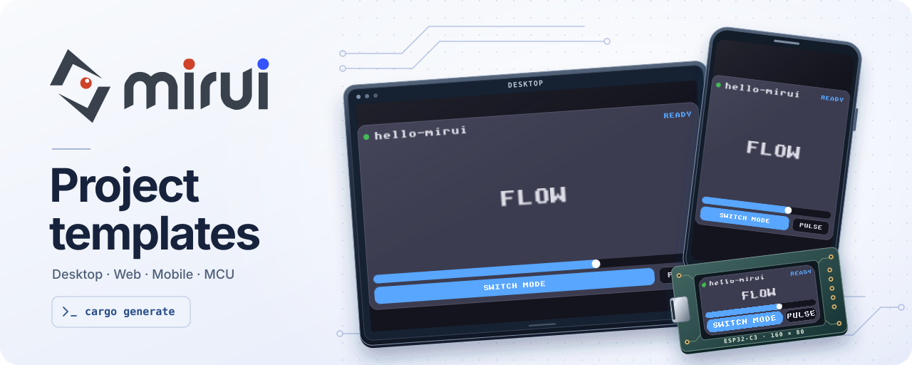

<picture>
  <source media="(prefers-color-scheme: dark)" srcset="assets/readme-hero-dark.svg" />
  
</picture>

[](https://github.com/W-Mai/mirui-templates/actions/workflows/ci.yml)

Start a [Mirui](https://github.com/W-Mai/mirui) project with [cargo-generate](https://github.com/cargo-generate/cargo-generate). Choose a standalone target or share one UI across a workspace.

[Quick start](#quick-start) · [Templates](#available-templates) · [Backends](#backend-and-target-coverage) · [Preview](#mobile-preview)

## Quick start

Install `cargo-generate` and create a desktop project.

```bash
cargo install cargo-generate
cargo generate --git https://github.com/W-Mai/mirui-templates.git templates/desktop --name hello-mirui
cd hello-mirui
cargo run
```

Use `templates/workspace` in the same command to generate a shared app and separate target crates. The template path is relative to the repository root. The generator prompts for the Mirui version and the rendering backends available for the selected template.

## Available templates

- **[Workspace](templates/workspace/README.md)** · One shared UI library with desktop, browser, ESP32-C3, Android, and iOS targets.
- **[Desktop](templates/desktop/README.md)** · Single-crate WGPU or SDL project.
- **[WebAssembly](templates/wasm/README.md)** · Browser Canvas 2D with [Trunk](https://trunkrs.dev) for local development.
- **[ESP32-C3](templates/esp32c3/README.md)** · Single-crate framebuffer app using esp-hal.
- **[Android](templates/android/README.md)** · Gradle-packaged NativeActivity app with WGPU or software rasterization.
- **[iOS](templates/ios/README.md)** · Xcode project for iPhone and iPad with WGPU or software rasterization.

## Generated UI

The generated application opens an interactive responsive card with mode buttons and a live slider. The same UI source runs across desktop, browser, mobile, and embedded targets; mobile roots keep content inside the current safe area automatically.

Shared UI is declared with `#[compose]`. Each target creates its root and installs the UI with `app.compose(root, template_app::build_ui())`. Widget event bodies read their payload through `event`, such as `event.new` for slider changes.

## Backend and target coverage

<details>
<summary>CI build matrix</summary>

| Runtime | Template | mirui feature | Verification |
|---------|----------|---------------|--------------|
| Desktop WGPU | `desktop`, `workspace/targets/desktop` | `wgpu` | CI build |
| SDL software | `desktop`, `workspace/targets/desktop` | `sdl` | CI build |
| Browser Canvas 2D | `wasm`, `workspace/targets/wasm` | `web-canvas` | CI WebAssembly build |
| Android WGPU | `android`, `workspace/targets/android` | `wgpu-android` | CI AArch64 APK build |
| Android software | `android`, `workspace/targets/android` | `wgpu-android` | CI AArch64 APK build |
| iOS WGPU | `ios`, `workspace/targets/ios` | `wgpu` | CI unsigned arm64 simulator app build |
| iOS software | `ios`, `workspace/targets/ios` | `wgpu` | CI unsigned arm64 simulator app build |
| ESP32-C3 framebuffer | `esp32c3`, `workspace/targets/esp32c3` | no backend feature | RISC-V cross-build; complete ST7735S wiring is verified in `mirui-examples` |

</details>

SDL projects build and statically link SDL2 through the `sdl2` crate's `bundled` and `static-link` features. A C compiler and CMake are needed to build; no separate SDL2 development package or `LIBRARY_PATH` setting is needed. A binary built for one operating system and architecture still depends on that platform's system libraries and cannot be treated as a universal executable.

mirui also exposes `sdl-gpu`, `linux-fb`, `linux-drm`, and `nuttx`. These backends do not have dedicated generator templates in this repository. ESP32-S3, RP2040, STM32, and other MCUs can reuse the shared `no_std` app structure, but need target-specific allocator, clock, input, framebuffer flush, and panel code.

The ESP32-C3 templates keep antialiasing and profiling explicit: enable `quad-aa` for transformed-edge quality or `perf` for frame timing. Both stay off by default so a generated firmware starts with the smaller embedded configuration.

## Mobile preview

Successful `main` CI runs publish test-signed Android APKs and unsigned arm64 iOS Simulator archives on the mutable [`mobile-preview`](https://github.com/W-Mai/mirui-templates/releases/tag/mobile-preview) prerelease. Version tags receive the same normalized assets on their immutable release. The Android preview key is generated for each CI run and is not a production identity; physical iOS devices require an Apple signing team.

## Pinning mirui

The per-template `cargo-generate.toml` files define the default semver requirement. Pass `--define mirui-version=0.X` to change the compatibility requirement.

## Maintenance

This repo tracks the [mirui](https://github.com/W-Mai/mirui) release cycle. `cargo xtask templates-bump` inside the mirui repo updates the per-template `cargo-generate.toml` version default.

The mirui version requirement in a generated project's `Cargo.toml` comes from the cargo-generate prompt. A generated `Cargo.lock` records the resolved crate versions.

Target runtime adapters live under `components/`. Run `python3 scripts/materialize_templates.py write` after editing an adapter; `python3 scripts/materialize_templates.py check` verifies that committed standalone and workspace targets match the canonical source.

## Contributing

To propose a new template, such as an additional MCU:

1. Add a canonical adapter under `components/targets/<name>/`, declare its standalone and workspace variants in `scripts/materialize_templates.py`, and add the public template metadata.
2. Verify locally:
   ```bash
   cargo generate --path templates/<name> --name testfoo
   cd testfoo && cargo build  # or cargo build --release for embedded
   ```
3. Add a job to `.github/workflows/ci.yml` that runs the same `cargo generate` and target build so CI catches regressions.
4. Update `README.md` and `CHANGELOG.md` with an entry for the new template.

For bug fixes to existing templates, file an issue with the exact `cargo generate` invocation, the cargo error, and your toolchain versions (`rustc -V`, `cargo -V`, `cargo generate -V`).

## See also

- [mirui](https://github.com/W-Mai/mirui) — the framework itself.
- [mirui-examples](https://github.com/W-Mai/mirui-examples) — hardware demos including the ST7735S board file used by the `esp32c3` template.

## License

MIT — see `LICENSE`.
